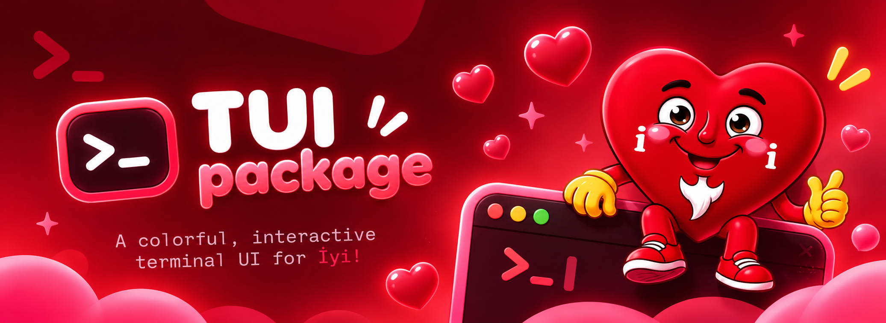
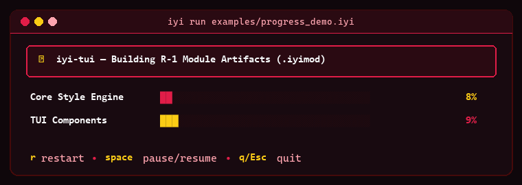
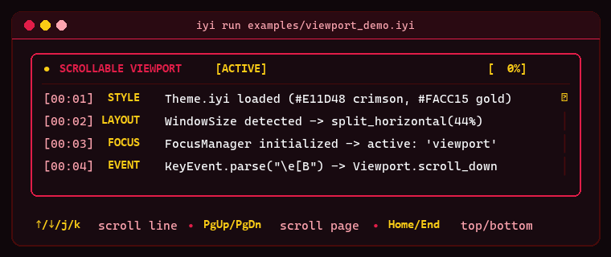
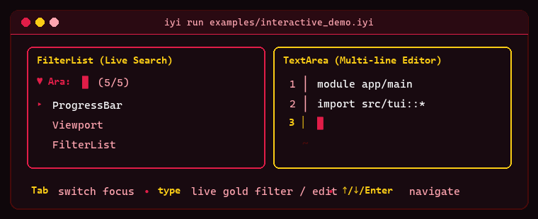

<p align="center">
  
  <p align="center">
    The fun, functional, and stateful way to build terminal apps in <a href="https://iyi.dev">iyi</a>.<br>
    A modular TUI framework for simple one-line prompts and rich full-screen terminal applications.
  </p>
  <p align="center">
    
    
  </p>
</p>

<p align="center">
  
</p>

<p align="center">
  
</p>

<p align="center">
  
</p>

## Features

- **One-liner prompts** — `TUI.select`, `TUI.multi_select`, `TUI.input`, and `TUI.confirm` work out of the box with zero boilerplate.
- **Declarative styling** — Immutable `Style` builder with 24-bit TrueColor RGB/Hex, 256-color palette, padding, margin, alignment, and box borders (`:single`, `:rounded`, `:double`, `:thick`).
- **Built-in components** — `ProgressBar`, `Viewport`, `FilterList`, `TextArea`, `Table`, `Tabs`, `Modal`, `Spinner`, and `HelpBar`.
- **Multi-panel layout** — Responsive `WindowSize` splits and `Tab` / `Shift+Tab` `FocusManager`.
- **Mouse support** — SGR mouse clicks (`is_click?`, `is_right_click?`), wheel scrolling (`is_wheel_up?`, `is_wheel_down?`), and hit-testing (`mouse.in_rect?`).
- **Cross-platform** — Runs on macOS, Linux, and Windows terminals with zero external C dependencies.

## Quick Start

### One-Liner Interactive Prompts

Need quick user input without writing a model or event loop? Import `TUI` and call a prompt directly:

```crystal
module app/cli

import src/tui::{TUI}

name     = TUI.input("Project name:", "my-app")
choice   = TUI.select("Pick a component:", ["ProgressBar", "Viewport", "FilterList", "TextArea"])
selected = TUI.multi_select("Enable features:", ["Tabs", "Modal", "Spinner", "HelpBar"])
proceed  = TUI.confirm("Start build?")
```

### Tutorial: Building a Stateful App

Full-screen apps follow an immutable **`Model` → `update` → `view`** loop.

First, declare your module and import `src/tui::*` (or pick individual types with `import src/tui::{Style, ProgressBar, KeyEvent}`):

```crystal
module app/main

import src/tui::*
```

Define your application state (`Model`) as an immutable `struct`:

```crystal
pub struct AppModel
  getter progress : ProgressBar
  getter spinner : Spinner
  getter quit : Bool

  def initialize(@progress : ProgressBar, @spinner : Spinner, @quit : Bool = false)
  end

  def self.initial : AppModel
    bar = ProgressBar.new(40, 32).with_label("Progress:")
    sp  = Spinner.dots("RUNNING")
    AppModel.new(bar, sp, false)
  end
end
```

Handle keyboard input in `update` — every event returns a new `AppModel`:

```crystal
  def update(key : KeyEvent) : AppModel
    return AppModel.new(@progress, @spinner, true) if key.is_quit?

    next_pct = @progress.percent
    if key.is_right? || key.is_up?
      next_pct = next_pct + 10
    elsif key.is_left? || key.is_down?
      next_pct = next_pct - 10
    end

    AppModel.new(@progress.with_percent(next_pct), @spinner.tick, false)
  end
```

Describe your UI in `view` by returning a `String`:

```crystal
  def view : String
    help = HelpBar.new([
      KeyBinding.on_any(["left", "right"], "←/→", "adjust"),
      KeyBinding.on("q", "q/Esc", "quit")
    ])

    card = Style.new_style
      .border(:rounded)
      .border_foreground(Theme.iyi.primary)
      .padding(1, 3)
      .render("#{@spinner.render}\n\n#{@progress.render}")

    Style.join_vertical([card, help.render])
  end
```

Finally, wire the raw-mode event loop with `Terminal` (pass `mouse: true` to receive mouse clicks and wheel scroll events):

```crystal
model = AppModel.initial

Terminal.enter_alt_screen
defer Terminal.exit_alt_screen

Terminal.with_raw_mode(mouse: true) do
  while !model.quit
    Terminal.cursor_home
    model.view.split('\n').each { |line| STDOUT.write(line + "\e[K\r\n") }
    STDOUT.write("\e[J")

    key = KeyEvent.read
    break if key.none?

    if key.is_click? && key.mouse.in_rect?(1, 1, 40, 6)
      model = model.update(KeyEvent.parse("\e[C"))
    else
      model = model.update(key)
    end
  end
end
```

### Mouse Support

Enable SGR mouse tracking with `Terminal.with_raw_mode(mouse: true)` (mouse reporting is automatically disabled on exit). `Viewport` and `Table` handle mouse wheel scrolling out of the box, and you can hit-test clicks anywhere on screen:

```crystal
if key.is_click?
  puts "Left click at col=#{key.mouse.x}, row=#{key.mouse.y}"
  if key.mouse.in_rect?(left: 2, top: 4, width: 30, height: 10)
    # Clicked inside panel
  end
elsif key.is_wheel_up?
  viewport = viewport.scroll_up
end
```

## Components

| Component | Description |
|---|---|
| `ProgressBar` | Clamped `0..100%` bar with labels, custom glyphs, and theme colors |
| `Viewport` | Scrollable text/log window (`↑/↓`, `PgUp/PgDn`, `Home/End`) with scrollbar |
| `FilterList` | Live searchable list with gold (`#FACC15`) substring match highlighting |
| `TextArea` | Multi-line UTF-8 editor with line numbers and 2D cursor navigation |
| `Table` | Column-aligned data table with ellipsis truncation and row selection |
| `Tabs` | Horizontal tab bar controllable via `←/→` and `1..9` |
| `Modal` | Word-wrapped dialog box with centered `render_over(screen)` overlay |
| `Spinner` | Animated status indicators (`Spinner.dots`, `Spinner.line`, `Spinner.pulse`) |
| `HelpBar` | Automatic bottom key-hint bar rendered from `KeyBinding` arrays |

## Running the Demo & Tests

```sh
iyi run examples/demo.iyi
iyi test tests
```

## AI Agents (`AGENTS.md`)

Using an AI coding agent with `iyi-tui`? Point it to **[`AGENTS.md`](AGENTS.md)** for the full exported API map, component recipes, and `iyi` module rules.

## License

[MIT](LICENSE)
